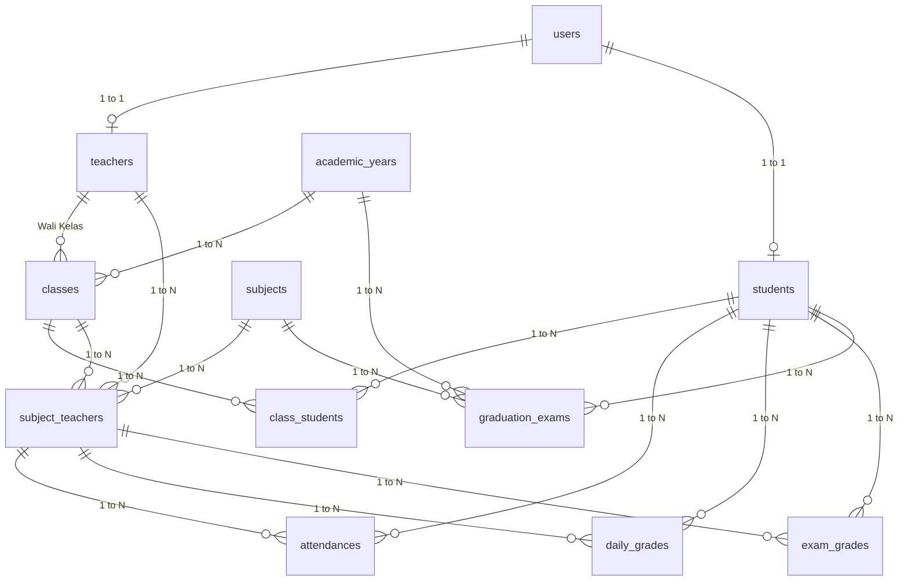

# SIAKAD SMP - Web Application Penilaian & Presensi Siswa

Sistem Informasi Akademik (SIAKAD) Penilaian dan Presensi Siswa Sekolah Menengah Pertama (SMP) adalah *full-stack web application* yang dirancang untuk mengelola seluruh ekosistem penilaian akademik, kehadiran siswa, serta evaluasi kelulusan/kenaikan kelas sesuai standar regulasi kurikulum SMP.

Aplikasi ini dibangun menggunakan arsitektur modern:
* **Frontend:** React 18, Vite, Tailwind CSS v4, React Router v6, Axios, Lucide Icons.
* **Backend:** C# .NET 8 ASP.NET Core Web API, Entity Framework Core (Pomelo MySQL), JWT Authentication.
* **Database:** MySQL Server (Database: `sekolah_db`, Port: `3306`, User: `root` tanpa password).

---

## Daftar Isi
- [Fitur Utama & Aturan Bisnis](#fitur-utama--aturan-bisnis)
- [Ketentuan Khusus Arsitektur Backend](#ketentuan-khusus-arsitektur-backend)
- [Struktur Direktori Proyek](#struktur-direktori-proyek)
  - [Struktur Backend (.NET 8 Web API)](#struktur-backend-net-8-web-api)
  - [Struktur Frontend (React.js + Vite)](#struktur-frontend-reactjs--vite)
- [Skema & 12 Tabel Database (MySQL)](#skema--12-tabel-database-mysql)
- [Kredensial Login Pengguna](#kredensial-login-pengguna)
- [Panduan Instalasi & Menjalankan](#panduan-instalasi--menjalankan)
- [Dokumentasi REST API Endpoints](#dokumentasi-rest-api-endpoints)

---

## Fitur Utama & Aturan Bisnis

Sistem mengimplementasikan seluruh aturan bisnis sesuai dokumen **Product Requirement Document (PRD)**:

1. **Kriteria Ketuntasan Minimal (KKM) Standar Tunggal (75.00):**
   * Batas kelulusan minimum seluruh mata pelajaran adalah **75.00**.
   * Nilai di bawah 75 secara visual otomatis ditandai *background highlight* merah muda (*Belum Tuntas / Perlu Remedi*).
2. **Restriksi Modul Ujian Kelulusan (Khusus Kelas 9):**
   * Modul Ujian Kelulusan hanya aktif untuk siswa dengan tingkatan kelas **9**.
   * Sistem secara otomatis menolak masukan nilai ujian kelulusan untuk siswa kelas 7 dan 8 baik di tingkat frontend maupun backend validation.
3. **Mekanisme Soft Delete & Proteksi Relasi (Referential Integrity - HTTP 422):**
   * Setiap tabel utama menggunakan *soft delete* (`deleted_at TIMESTAMP NULL`).
   * Sebelum mengeksekusi penghapusan, sistem memvalidasi keberadaan data anak aktif.
   * Jika relasi anak masih aktif ditemukan, sistem mengembalikan respon galat **HTTP 422 Unprocessable Entity** dengan rincian tabel terkait.
4. **Algoritma Penilaian Terotomatisasi:**
   * **Kelas 7 & 8 (Semester):**
     $$NA = (0.30 \times R_{TH}) + (0.30 \times UTS) + (0.40 \times UAS/UKK)$$
   * **Kelas 9 (Kelulusan):**
     $$NA_{Lulus} = (0.60 \times \overline{\text{Rapor S1–S5}}) + (0.40 \times \text{GraduationExam.final\_score})$$
5. **Kuncian Periode Nilai (*Locking Period*):**
   * Wakil Kepala Sekolah (Wakasek Kurikulum) dan Admin dapat mengunci tahun ajaran (`is_locked = true`) untuk membekukan penginputan nilai/presensi sebelum pleno rapor.

---

## Ketentuan Khusus Arsitektur Backend

Sesuai spesifikasi kebutuhan teknis:

### 1. Restful API Queue (Asynchronous Background Worker)
* **Mekanisme:** Menggunakan `System.Threading.Channels.Channel<JobDto>` dengan kapasitas antrean terkontrol (*bounded channel*).
* **Worker:** Dieksekusi secara asynchronous di latar belakang oleh `JobQueueWorker` yang mengimplementasikan `BackgroundService`.
* **Kegunaan:** Pemrosesan generasi rapor siswa skala besar, rekapitulasi kelas, dan ekspor data berat tanpa memblokir request thread HTTP.
* **REST API Endpoints:**
  * `POST /api/queue/jobs` : Mengirim tugas baru (merespons dengan `202 Accepted` + URL status tugas).
  * `GET /api/queue/jobs/{id}` : Melakukan *polling* status progres (0% $\rightarrow$ 100%).
  * `GET /api/queue/jobs` : Menampilkan seluruh antrean tugas aktif dan riwayatnya.
* Terdapat halaman UI dedicated pada frontend (`/queue/jobs`) untuk memantau progres tugas secara visual dan *real-time*.

### 2. Query Optimizing (Optimalisasi Kueri Database)
* **AsNoTracking:** Seluruh operasi *read-only* memanfaatkan `.AsNoTracking()` untuk menonaktifkan overhead change tracker EF Core.
* **Proyeksi DTO (`.Select()`):** Memilih secara presisi kolom-kolom data yang dibutuhkan agar tidak terjadi *over-fetching*.
* **Paginasi Efisien (`ToPagedListAsync`):** Menggunakan paging berbasis *skip & take* terstandarisasi untuk menjaga efisiensi RAM server.
* **Composite Indexing:** Diterapkan indeks komposit pada database untuk mempercepat kueri berulang:
  * `daily_grades(subject_teacher_id, student_id)`
  * `exam_grades(subject_teacher_id, student_id, exam_type)`
  * `attendances(subject_teacher_id, date)`
  * `graduation_exams(academic_year_id, student_id, subject_id)`
  * `students(full_name)`, `teachers(full_name)`

### 3. Fitur Search Seperti Search Engine
* **Endpoint:** `GET /api/search?q={query}&type={type}`
* **Multi-Entity Search:** Mencari secara simultan pada data Siswa, Guru & Pejabat, Rombel Kelas, dan Mata Pelajaran.
* **Weighted Relevance Scoring:**
  * **Exact Match (100 Poin):** Kata kunci identik persis dengan target field.
  * **Prefix Match (75 Poin):** Kata kunci berada di awal kata/kalimat.
  * **Contains Match (50 Poin):** Kata kunci terkandung di dalam teks.
  * **Tokenized Word Matching:** Mendukung query multi-term (contoh: *"Matematika 7"*).
* **Metadata Hasil:** Mengembalikan waktu eksekusi dalam milidetik (*execution time in ms*), statistik jumlah hasil per kategori, badge relevansi persentase, dan tautan langsung ke detail entitas.

---

## Struktur Direktori Proyek

```
Sekolah/
├── backend/                  # REST API Backend (C# .NET 8)
│   └── SekolahApi/
├── frontend/                 # Single Page Application (React 18 + Vite)
│   └── src/
├── prd.md                    # Product Requirement Document acuan
├── implementation-plan.md    # Rencana implementasi
├── .gitignore                # Aturan ignore file git
└── README.md                 # Dokumentasi proyek
```

### Struktur Backend (.NET 8 Web API)
```
backend/SekolahApi/
├── BackgroundJobs/
│   └── JobQueueWorker.cs               # Background worker untuk antrean asynchronous
├── Controllers/
│   ├── AcademicYearsController.cs      # Manajemen tahun ajaran & kuncian nilai
│   ├── AttendancesController.cs        # Input & rekap presensi tatap muka
│   ├── AuthController.cs               # Login JWT & ubah password
│   ├── ClassesController.cs            # Manajemen rombel kelas (7, 8, 9)
│   ├── ClassStudentsController.cs      # Plotting siswa ke kelas
│   ├── DailyGradesController.cs        # Input nilai tugas/kuis harian
│   ├── DashboardController.cs          # Statistik Admin, Guru, & Eksekutif
│   ├── ExamGradesController.cs         # Input nilai ujian UTS, UAS, & UKK
│   ├── GraduationExamsController.cs    # Ujian kelulusan terisolasi khusus kelas 9
│   ├── QueueController.cs              # Endpoint Restful API Queue
│   ├── ReportsController.cs            # Kalkulasi nilai rapor & kelulusan
│   ├── SearchController.cs             # Mesin pencari multi-entitas
│   ├── StudentsController.cs           # Master data siswa
│   ├── SubjectsController.cs           # Master data mata pelajaran (KKM 75)
│   ├── SubjectTeachersController.cs    # Penugasan guru pengampu mapel
│   ├── TeachersController.cs           # Master data guru & pejabat
│   └── UsersController.cs              # Manajemen akun & hak akses
├── Data/
│   ├── AppDbContext.cs                 # EF Core DbContext, indeks, query filter, & proteksi 422
│   ├── DbSeeder.cs                     # Inisialisasi data awal (Admin, Rombel, Mapel, Siswa)
│   └── ReferentialConstraintException.cs # Exception khusus pelanggaran proteksi soft delete
├── Helpers/
│   └── QueryOptimizer.cs               # Extension method paginasi & optimasi IQueryable
├── Middleware/
│   └── ExceptionHandlingMiddleware.cs  # Handler global respon error & HTTP 422
├── Models/
│   ├── DTOs/
│   │   ├── AcademicYears/              # DTO Tahun Ajaran
│   │   ├── Auth/                       # DTO Login, Response Token, User Info
│   │   ├── Classes/                    # DTO Kelas, Plotting Siswa, Penugasan Guru
│   │   ├── Common/                     # PagedResult & PaginationQuery
│   │   ├── Grades/                     # DTO Presensi, Nilai Harian, Nilai Ujian, Kelulusan
│   │   ├── Queue/                      # DTO Antrean Tugas Background
│   │   ├── Reports/                    # DTO Rekapitulasi Rapor & SKL
│   │   ├── Search/                     # DTO Hasil Pencarian Terbobot
│   │   ├── Students/                   # DTO Siswa
│   │   ├── Subjects/                   # DTO Mata Pelajaran
│   │   └── Teachers/                   # DTO Guru
│   ├── Entities/
│   │   ├── AcademicYear.cs
│   │   ├── Attendance.cs
│   │   ├── BaseEntity.cs               # Base id, created_at, updated_at, deleted_at
│   │   ├── Class.cs
│   │   ├── ClassStudent.cs
│   │   ├── DailyGrade.cs
│   │   ├── ExamGrade.cs
│   │   ├── GraduationExam.cs
│   │   ├── Student.cs
│   │   ├── Subject.cs
│   │   ├── SubjectTeacher.cs
│   │   ├── Teacher.cs
│   │   └── User.cs
│   └── Enums/
│       ├── AttendanceStatus.cs         # HADIR, IZIN, SAKIT, ALPA
│       ├── ExamType.cs                 # UTS, UAS, UKK
│       ├── Gender.cs                   # L, P
│       ├── Semester.cs                 # GANJIL, GENAP
│       ├── StudentStatus.cs            # AKTIF, LULUS, MUTASI
│       ├── TeacherPosition.cs          # GURU, WAKASEK, KEPSEK
│       └── UserRole.cs                 # ADMIN, GURU, WALIKELAS, WAKASEK, KEPSEK, SISWA
├── Services/
│   ├── Auth/
│   │   ├── AuthService.cs              # Implementasi otentikasi JWT & BCrypt
│   │   └── IAuthService.cs
│   ├── Queue/
│   │   ├── BackgroundJobQueue.cs       # Implementasi Channel In-Memory Queue
│   │   └── IBackgroundJobQueue.cs
│   └── Search/
│       ├── ISearchEngineService.cs
│       └── SearchEngineService.cs      # Algoritma relevance ranking pencarian
├── appsettings.json                    # Konfigurasi koneksi MySQL & JWT Key
├── Program.cs                          # Konfigurasi Dependency Injection & Pipeline
└── SekolahApi.csproj                   # Paket NuGet dependencies
```

### Struktur Frontend (React.js + Vite)
```
frontend/src/
├── api/
│   └── axios.js                        # Konfigurasi Axios client, Bearer token, & error interceptor
├── components/
│   ├── common/
│   │   ├── Badge.jsx                   # Badge status
│   │   ├── ConfirmDialog.jsx           # Dialog konfirmasi aksi berbahaya
│   │   ├── DataTable.jsx               # Komponen tabel dinamis dengan sort, search, & pagination
│   │   ├── LoadingSpinner.jsx          # Indikator loading
│   │   ├── Modal.jsx                   # Reusable modal pop-up
│   │   ├── Pagination.jsx              # Kontrol halaman data
│   │   └── SearchBar.jsx               # Quick search bar pada header
│   ├── forms/
│   │   ├── ClassForm.jsx
│   │   ├── GradeForm.jsx
│   │   ├── StudentForm.jsx
│   │   ├── SubjectForm.jsx
│   │   ├── TeacherForm.jsx
│   │   └── UserForm.jsx
│   └── layout/
│       ├── AppLayout.jsx               # Shell layout utama
│       ├── Header.jsx                  # Header navigasi, profile bar, & tombol logout
│       └── Sidebar.jsx                 # Navigasi bertingkat berbasis 6 User Role
├── contexts/
│   └── AuthContext.jsx                 # State otentikasi user & token JWT
├── hooks/
│   ├── useAuth.js                      # Custom hook akses konteks otentikasi
│   └── usePagination.js                # Custom hook kalkulasi paginasi
├── pages/
│   ├── admin/
│   │   ├── AcademicYearsPage.jsx       # Kelola TA & kuncian nilai (Locking)
│   │   ├── ClassesPage.jsx             # Kelola rombongan belajar
│   │   ├── ClassStudentsPage.jsx       # Plotting siswa ke rombel
│   │   ├── StudentsPage.jsx            # Master data siswa
│   │   ├── SubjectsPage.jsx            # Master data mapel (KKM 75)
│   │   ├── SubjectTeachersPage.jsx     # Penugasan guru pengampu mapel
│   │   ├── TeachersPage.jsx            # Master data guru & staff
│   │   └── UsersPage.jsx               # Manajemen pengguna & role
│   ├── auth/
│   │   └── LoginPage.jsx               # Form login & selector akun uji coba cepat
│   ├── dashboard/
│   │   ├── AdminDashboard.jsx          # Dashboard metrik Administrator
│   │   ├── PrincipalDashboard.jsx      # Dashboard eksekutif Kepala Sekolah / Wakasek
│   │   └── TeacherDashboard.jsx        # Dashboard penugasan & jadwal Guru
│   ├── homeroom/
│   │   ├── AttendanceRecapPage.jsx     # Rekap absensi & nilai rombel wali kelas
│   │   └── ReportCardPage.jsx          # Cetak rapor resmi siswa & ekspor antrean PDF
│   ├── queue/
│   │   └── QueueJobsPage.jsx           # Visualisasi pemantauan antrean tugas background
│   ├── search/
│   │   └── SearchResultsPage.jsx       # Halaman hasil pencarian mesin pencari
│   ├── student/
│   │   ├── MyAttendancePage.jsx        # Rekap kehadiran mandiri siswa
│   │   ├── MyGradesPage.jsx            # Rapor hasil belajar mandiri siswa (KKM 75 highlight)
│   │   └── MyProfilePage.jsx           # Biodata diri siswa
│   ├── teacher/
│   │   ├── AttendancePage.jsx          # Input presensi pertemuan guru
│   │   ├── DailyGradesPage.jsx         # Input nilai tugas harian (KKM 75 highlight)
│   │   ├── ExamGradesPage.jsx          # Input nilai UTS, UAS, & UKK (KKM 75 highlight)
│   │   └── GraduationExamsPage.jsx     # Ujian kelulusan khusus kelas 9
│   └── vice-principal/
│       └── GraduationPage.jsx          # Evaluasi kelulusan & rekomendasi pleno SKL Kls 9
├── utils/
│   ├── constants.js                    # Konstanta Role, KKM=75, Bobot, Status
│   └── gradeCalculation.js             # Formula kalkulasi pembobotan nilai
├── App.jsx                             # Router utama & Protected Route per peran
├── index.css                           # Import Tailwind CSS v4
├── main.jsx                            # Entry point React DOM
└── package.json                        # Frontend dependencies & scripts
```

---

## Skema & 12 Tabel Database (MySQL)

Database MySQL `sekolah_db` terdiri atas 12 tabel yang saling berelasi lengkap dengan *audit timestamps* (`created_at`, `updated_at`) serta *soft delete tracking* (`deleted_at`):



1. **`users`** : Kredensial akun, username, password ter-hash BCrypt, enum `role`.
2. **`academic_years`** : Tahun ajaran (`2025/2026`), semester (`GANJIL`/`GENAP`), status `is_active`, dan kuncian nilai `is_locked`.
3. **`teachers`** : NIP, nama lengkap, gender (`L`/`P`), jabatan (`GURU`/`WAKASEK`/`KEPSEK`), signature path.
4. **`students`** : NISN (10 digit), NIS, nama lengkap, gender, tanggal lahir, status (`AKTIF`/`LULUS`/`MUTASI`).
5. **`subjects`** : Kode mapel (cth: `MAT-7`), nama mapel, standar KKM tetap `75.00`.
6. **`classes`** : Rombongan belajar tingkat 7, 8, dan 9 beserta wali kelas.
7. **`class_students`** : Plotting siswa ke dalam rombel kelas per tahun ajaran.
8. **`subject_teachers`** : Penugasan guru mengampu mata pelajaran pada kelas tertentu.
9. **`attendances`** : Rekap presensi pertemuan harian (`HADIR`, `IZIN`, `SAKIT`, `ALPA`).
10. **`daily_grades`** : Penilaian tugas/kuis harian ($R_{TH}$) dengan rentang nilai 0–100.
11. **`exam_grades`** : Penilaian ujian semester (`UTS`, `UAS`, `UKK`).
12. **`graduation_exams`** : Penilaian Ujian Tulis & Praktik kelulusan (terisolasi khusus siswa Kelas 9).

---

## Kredensial Login Pengguna

Database telah dilengkapi dengan *seeding data* otomatis untuk menguji seluruh 6 peran (*user roles*):

| Peran (Role) | Username | Password | Deskripsi Wewenang & Akses |
| :--- | :--- | :--- | :--- |
| **Administrator** | `admin` | `admin123` | Master data lengkap, konfigurasi sistem, kuncian nilai, manajemen user |
| **Guru Mapel** | `guru1` | `password123` | Guru Budi: Input presensi, nilai tugas harian, dan nilai ujian kelas yang diampu |
| **Wali Kelas** | `guru2` | `password123` | Guru Siti: Wali kelas 9-A & guru mapel, rekapitulasi kehadiran rombel, cetak rapor |
| **Wakasek Kurikulum** | `wakasek` | `password123` | Pak Hendra: Kontrol kuncian nilai rapor & pengawasan evaluasi kelulusan Kelas 9 |
| **Kepala Sekolah** | `kepsek` | `password123` | Ibu Nurhayati: Dashboard eksekutif, rekap capaian sekolah, persetujuan rapor |
| **Siswa** | `siswa1` | `password123` | Siswa Ahmad Dani (Kelas 7-A): Melihat profil, presensi mandiri, nilai rapor KKM 75 |

---

## Panduan Instalasi & Menjalankan

### Prasyarat Sistem
* [.NET 8.0 SDK](https://dotnet.microsoft.com/download/dotnet/8.0)
* [Node.js](https://nodejs.org/) (versi 18 ke atas)
* [MySQL Server](https://dev.mysql.com/downloads/) (atau via Laragon / XAMPP)

### 1. Menyiapkan Database MySQL
Pastikan service MySQL berjalan pada port `3306`, lalu buat database `sekolah_db`:
```sql
CREATE DATABASE IF NOT EXISTS sekolah_db CHARACTER SET utf8mb4 COLLATE utf8mb4_unicode_ci;
```

Konfigurasi koneksi tersimpan pada `backend/SekolahApi/appsettings.json`:
```json
"ConnectionStrings": {
  "DefaultConnection": "Server=localhost;Port=3306;Database=sekolah_db;User=root;Password=;AllowUserVariables=True;"
}
```

### 2. Menjalankan Backend (.NET 8 REST API)
```bash
cd backend/SekolahApi
dotnet restore
dotnet build
dotnet run --urls "http://localhost:5000"
```
*API otomatis melakukan migrasi tabel database dan men-seed data awal saat pertama kali dijalankan.*
* Akses API: `http://localhost:5000`
* Swagger UI Dokumentasi: `http://localhost:5000/swagger`

### 3. Menjalankan Frontend (React.js)
```bash
cd frontend
npm install
npm run dev
```
* Buka browser pada alamat: `http://127.0.0.1:5173`

---

## Dokumentasi REST API Endpoints

### Otentikasi
* `POST /api/auth/login` : Login akun & generate token JWT.
* `POST /api/auth/change-password` : Ganti password pengguna.
* `GET /api/auth/me` : Mendapatkan profil pengguna yang sedang login.

### Master Data (Admin)
* `GET|POST|PUT|DELETE /api/users` : Manajemen data akun pengguna.
* `GET|POST|PUT|DELETE /api/academic-years` : Manajemen tahun ajaran.
* `PATCH /api/academic-years/{id}/toggle-lock` : Mengunci/membuka penginputan nilai.
* `PATCH /api/academic-years/{id}/set-active` : Mengatur tahun ajaran aktif.
* `GET|POST|PUT|DELETE /api/teachers` : Manajemen data guru & jabatan.
* `GET|POST|PUT|DELETE /api/students` : Manajemen data siswa.
* `GET|POST|PUT|DELETE /api/subjects` : Manajemen data mata pelajaran (KKM 75).
* `GET|POST|PUT|DELETE /api/classes` : Manajemen rombel kelas (7, 8, 9).
* `GET|POST|DELETE /api/class-students` : Plotting siswa ke rombel kelas.
* `GET|POST|DELETE /api/subject-teachers` : Penugasan guru pengampu mapel.

### Penilaian & Presensi (Guru)
* `GET /api/attendances?subjectTeacherId={id}&date={date}` : Data presensi pertemuan.
* `POST /api/attendances/bulk` : Simpan masal presensi siswa.
* `GET /api/daily-grades?subjectTeacherId={id}&taskTitle={title}` : Data nilai harian.
* `POST /api/daily-grades/bulk` : Simpan masal nilai tugas harian.
* `GET /api/exam-grades?subjectTeacherId={id}&examType={type}` : Data nilai UTS/UAS/UKK.
* `POST /api/exam-grades/bulk` : Simpan masal nilai ujian semester.
* `GET|POST /api/graduation-exams` : Input nilai ujian kelulusan (khusus Kelas 9).

### Laporan Rapor & Kelulusan
* `GET /api/reports/student-report-card/{studentId}` : Kalkulasi formulasi nilai rapor siswa.
* `GET /api/reports/class-recap/{classId}` : Rekapitulasi nilai & presensi rombel wali kelas.
* `GET /api/reports/graduation/{academicYearId}` : Rekapitulasi rekomendasi kelulusan Kelas 9.

### Layanan Sistem
* `GET /api/search?q={query}&type={type}` : Mesin pencari multi-entitas terbobot.
* `POST /api/queue/jobs` : Enqueue tugas background (mengembalikan 202 Accepted).
* `GET /api/queue/jobs/{id}` : Cek status & progres tugas antrean.
* `GET /api/queue/jobs` : Daftar seluruh antrean tugas.
* `GET /api/dashboard/{admin|teacher|principal}` : Metrik dan statistik dashboard.

